# Entrega 07: dashboard

> **Não entregue (14/10, R71, R72).** O dashboard vai na entrega final de 27/10, sem entrega própria. Este rascunho foi substituído pelo `entrega-07.md`, que também não foi entregue e fica como base da parte do dashboard na entrega final.

## Capa

UNIVERSIDADE VEIGA DE ALMEIDA
Bacharelado em Ciência da Computação

GABRIEL ALBUQUERQUE VARELA SANTARELLO – 1240110815
CAUÃ MANUEL PROENÇA DE ANDRADE – 1240109764
IGOR ROCHA LOBATO – 1240114118
CAIO PARADA OLIVEIRA PLANINSCHEK – 1240205596
JOÃO VICTOR BERÇOT CHABUDET CABRAL – 1240108001

**PRESENTE!**
DISPOSITIVO EMBARCADO PARA CONTABILIZAÇÃO DE PRESENÇA EM SALA DE AULA

(Trabalho da disciplina de Sistemas Embarcados)
Entrega 07: dashboard

Professor: Thiago Alberto Ramos Gabriel

Rio de Janeiro RJ
2026

## Resumo

Este documento apresenta o dashboard do Presente!, terminal embarcado que registra a presença do aluno em sala de aula pela aproximação do crachá, montado com o microcontrolador ESP32 e o leitor RFID RC522. O dashboard tem duas partes. A primeira é o portal do professor, uma página servida pelo próprio ESP32, numa rede Wi-Fi que o aparelho põe no ar: o celular do professor entra nessa rede, a página de login abre sozinha, e é por ela que o professor inicia a chamada, acompanha a contagem dos presentes, vê o relatório e envia a chamada ao banco na nuvem. A segunda é a página de histórico, publicada na internet, que lê do banco as aulas já registradas, com os presentes e os faltantes de cada uma, e exige login. Como o enunciado desta entrega não foi publicado até 13/10, seguimos o cronograma de 05/09, que pede um "dashboard (ESP32 obrigatório) ou interface Serial/Processing". O documento mostra as telas do portal rodando no navegador com um aparelho simulado e a página de histórico no ar, com os dados de teste do banco, e declara o que ainda não rodou: o portal servido pela placa, já ligado ao aparelho de verdade, tem o teste marcado para a aula de 13/10, e a chamada completa no aparelho depende das duas partes do programa que faltam escrever.

Palavras-chave: dashboard; ESP32; portal cativo; registro de presença; Supabase.

## 1 O QUE É O DASHBOARD DO PRESENTE!

O professor não instala aplicativo. Ao chegar à sala, ele conecta o celular na rede Wi-Fi do aparelho, e o ESP32 responde como um portal cativo, o mesmo mecanismo das redes de hotel: o celular abre sozinho a página de login. Essa página, com as telas que vêm depois dela, é o portal do professor, e é a parte do dashboard que roda no ESP32. Os arquivos do portal ficam gravados na memória da placa, numa área separada do programa, e o aparelho os entrega pela própria rede, sem internet.

O portal conversa com o aparelho por um conjunto fixo de mensagens, descrito na especificação do projeto, entre elas as do login, do estado da chamada, do Iniciar, da presença lançada à mão, do relatório, do envio e do encerramento. Para desenvolver as telas sem a placa, o grupo mantém um aparelho simulado, um arquivo que responde a essas mesmas mensagens dentro do navegador. Ele só entra quando se pede por ele no endereço da página, com `?mentira=1`; sem isso, o portal fala com o aparelho de verdade.

A segunda parte é a página de histórico. Ao fim da aula, o aparelho envia a chamada a um banco de dados na nuvem, na plataforma Supabase, e a página de histórico lê esse banco pela internet. Ela não conversa com o aparelho e não altera nada no banco. O endereço dela é público, mas a leitura exige e-mail e senha: sem login, o banco não entrega aula nenhuma. O Quadro 1 resume as duas partes.

| Parte | Onde roda | Com quem fala | Quem usa |
|---|---|---|---|
| Portal do professor | No ESP32, pela rede Wi-Fi do aparelho | Com o aparelho | O professor, durante a aula |
| Página de histórico | Na internet (GitHub Pages) | Com o banco na nuvem | Quem tem login no banco, depois da aula |

*Quadro 1 – As duas partes do dashboard. Fonte: os autores (2026).*

## 2 O PORTAL DO PROFESSOR

As figuras desta seção foram capturadas em 13/10, no navegador do computador, em largura de celular, com o aparelho simulado. Os nomes da turma vêm da lista de teste do aparelho simulado, e a nota no pé da tela de login, que dá o usuário e a senha de teste, só aparece com ele.

### 2.1 Login e busca da turma

O professor entra com usuário e senha (Figura 1). Aceita a senha, o aparelho busca a lista da turma no banco, pela internet de um hotspot de celular, e enquanto isso o portal mostra a tela "Carregando turma…", com um contador de segundos (Figura 2). Se a busca não der certo em 20 segundos, o aparelho segue sem a lista, no modo offline, e aceita todo crachá; o banco confere os alunos depois.

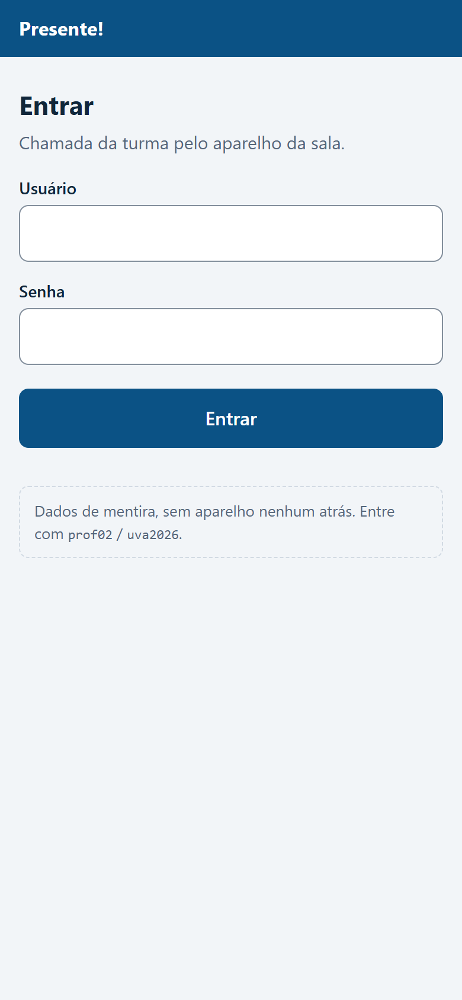

*Figura 1 – Tela de login do portal. Fonte: os autores (2026).*

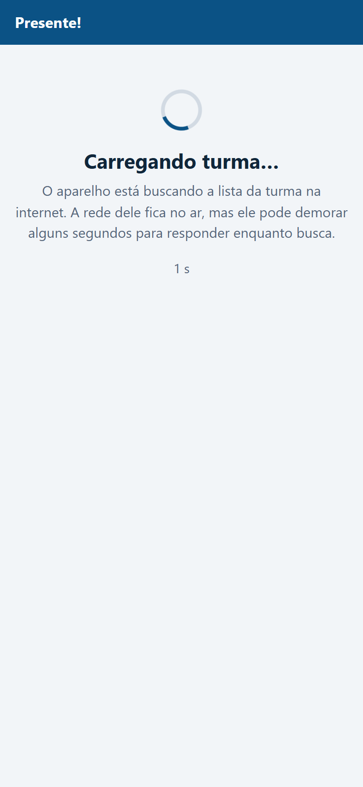

*Figura 2 – Tela de espera enquanto o aparelho busca a lista da turma. Fonte: os autores (2026).*

### 2.2 O painel e a chamada

Com a lista carregada, o painel mostra o professor, a disciplina, o modo (com a lista ou sem ela) e seis ações (Figura 3). O Iniciar abre a chamada, e a partir daí o painel conta os presentes e mostra o último crachá lido, com o nome e a hora (Figura 4). O portal pergunta o estado ao aparelho a cada 2 segundos.

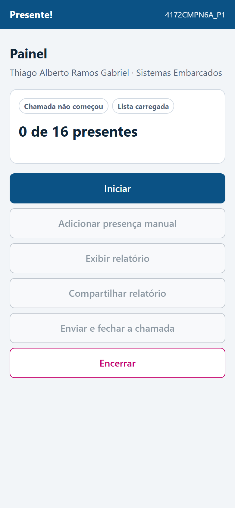

*Figura 3 – Painel antes de iniciar a chamada. Fonte: os autores (2026).*

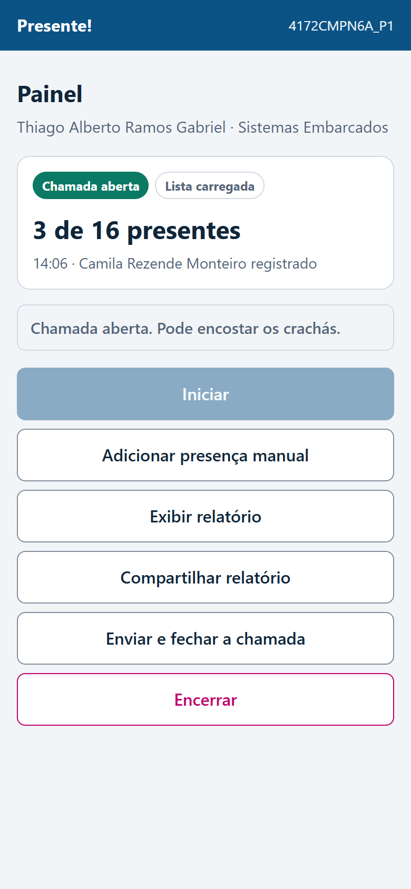

*Figura 4 – Painel com a chamada aberta e três presentes. Fonte: os autores (2026).*

### 2.3 Relatório, envio e encerramento

O relatório lista os presentes, com a matrícula e a hora da leitura, e os faltantes da turma (Figura 5). O botão "Enviar e fechar a chamada" manda a chamada ao banco; com o envio confirmado, o leitor para de registrar, e o painel diz que a chamada está fechada (Figura 6). Se o professor tocar de novo no botão, o aparelho responde que a chamada já tinha sido enviada, e nada se duplica. O Encerrar pede confirmação (Figura 7) e devolve o aparelho à tela de login, pronto para o próximo professor.

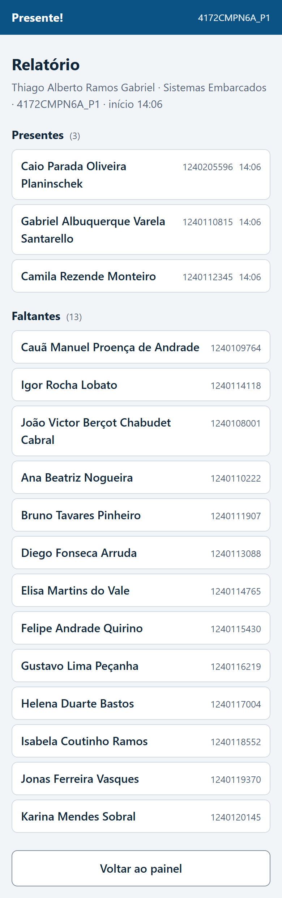

*Figura 5 – Relatório com presentes e faltantes. Fonte: os autores (2026).*

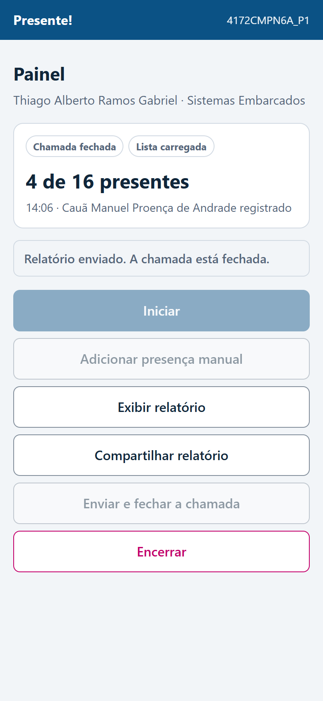

*Figura 6 – Painel depois do envio, com a chamada fechada. Fonte: os autores (2026).*

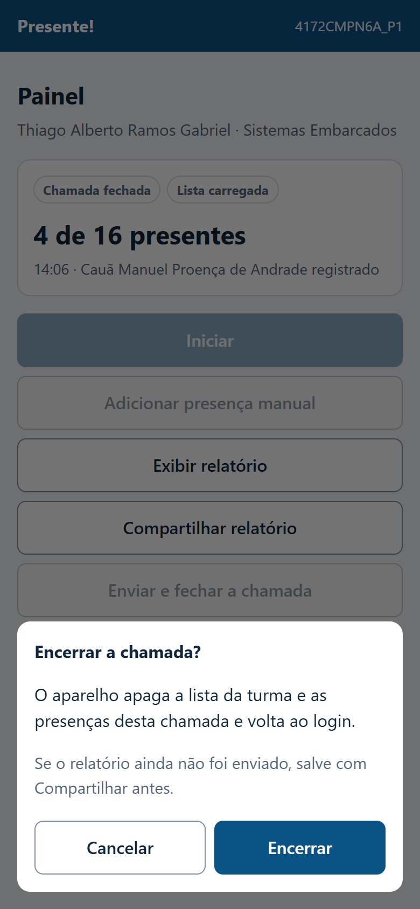

*Figura 7 – Confirmação do Encerrar. Fonte: os autores (2026).*

### 2.4 Regras que o portal segue

Nenhuma tela avança sem o aparelho confirmar. Todo pedido tem tempo-limite: 6 segundos, e 25 no envio, que é o único que sai da sala e vai à internet. Quando o aparelho não responde ou recusa, o portal mostra a falha, libera o botão e deixa a tela onde está, para o professor não achar que o aparelho obedeceu. O portal manda junto, no login e no Iniciar, a hora do celular, porque o ESP32 não tem relógio com bateria e é essa hora que data a chamada. E, se a página recarregar com a chamada aberta, o portal pergunta o estado ao aparelho e volta direto ao painel, sem pedir a senha de novo. Conferimos essas regras no navegador, com o aparelho simulado; no aparelho de verdade, elas ainda não foram testadas.

## 3 A PÁGINA DE HISTÓRICO

A página de histórico está publicada em https://caioplaninschek.github.io/presente/ e abre pedindo e-mail e senha (Figura 8). As figuras desta seção foram capturadas em 13/10, na página no ar, com um login do grupo e os dados de teste do banco: seis aulas inventadas da turma `4172CMPN6A_P1` e quatro deixadas pelas verificações automáticas do banco, da turma `TESTE01`.

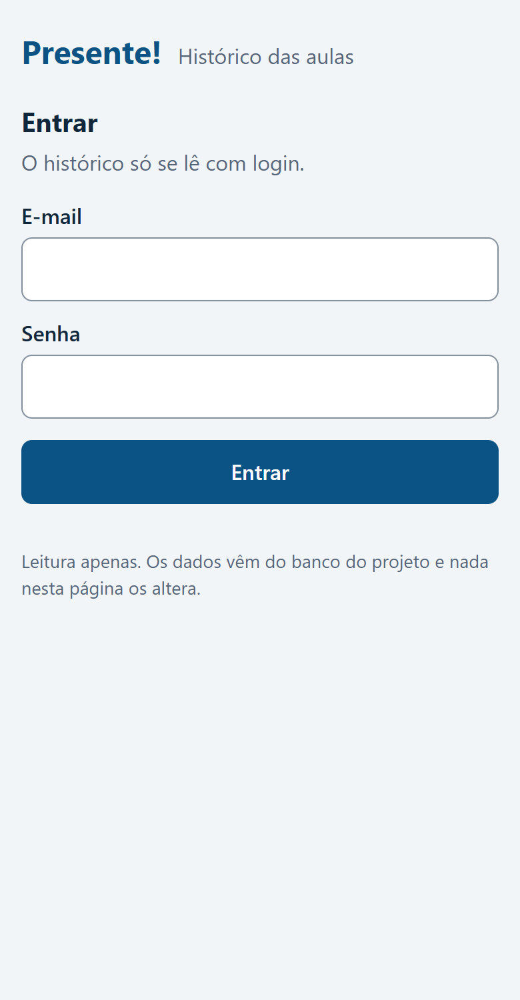

*Figura 8 – Tela de login da página de histórico. Fonte: os autores (2026).*

A lista mostra as aulas da mais recente para a mais antiga, cada uma com a data e a hora, o professor, a turma, a disciplina, a situação e o modo (Figura 9). A situação diz se a aula foi finalizada ou cancelada, e o modo diz se o aparelho tinha a lista da turma ("Com internet") ou não ("Sem internet"). A página também distingue a aula ainda aberta, mas nenhuma aula do banco está nessa situação, e por isso ela não aparece na figura.

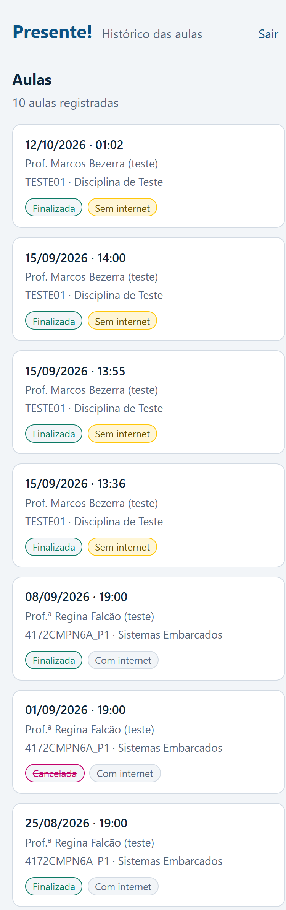

*Figura 9 – Lista das aulas registradas no banco. Fonte: os autores (2026).*

Ao abrir uma aula, a página mostra os presentes, cada aluno uma vez só, com a matrícula e o horário da primeira leitura, e os faltantes da turma. A presença lançada à mão pelo professor vem marcada, com o motivo e quem a lançou. As Figuras 10 e 11 são o começo e o fim da aula de teste de 18/08, sem internet: 34 presentes, um deles lançado à mão porque o aluno esqueceu o crachá, e 6 faltantes.

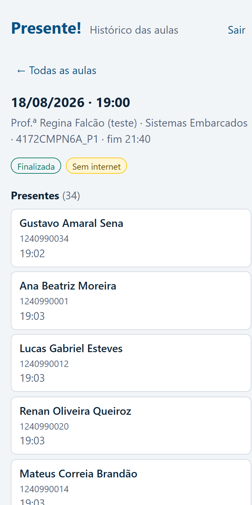

*Figura 10 – Começo da aula de 18/08, com os presentes. Fonte: os autores (2026).*

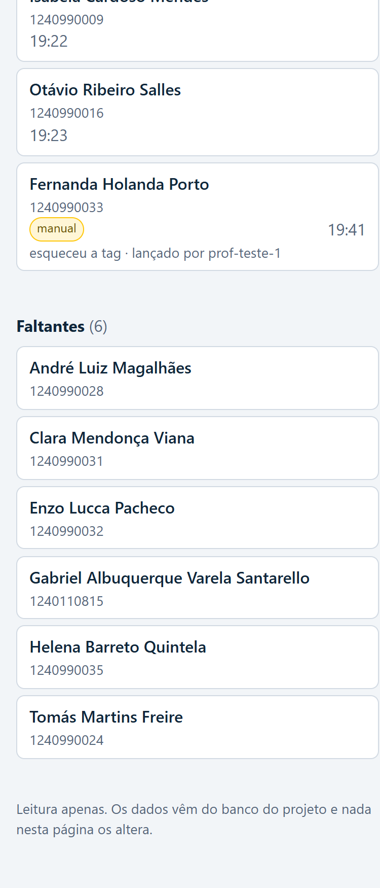

*Figura 11 – Fim da mesma aula, com a presença lançada à mão e os faltantes. Fonte: os autores (2026).*

Nenhuma credencial do banco fica no repositório. A cada publicação, o GitHub monta o arquivo de configuração com o endereço do banco e a chave publicável dele, guardados como segredos do repositório. Essa chave fica visível para quem abre a página, mas sozinha não lê nada, porque o banco só libera a leitura depois do login.

## 4 O QUE JÁ RODA E O QUE FALTA

O Quadro 2 separa o que foi conferido do que ainda não rodou. A placa da caixa tem gravadas as duas primeiras das cinco partes do programa único do aparelho: o portal dentro do ESP32, com a rede própria e o login (parte 1), e a busca da lista da turma pela internet (parte 2). A parte 2 foi testada de modo informal em 12/10, pelo monitor serial, sem o portal ligado ao aparelho de verdade.

| O quê | Situação em 13/10 | Como foi conferido |
|---|---|---|
| Portal no navegador, com o aparelho simulado, do login ao Encerrar | Funciona | No navegador do computador, em 13/10 (Figuras 1 a 7) |
| Página de histórico no ar, com login e as aulas de teste do banco | Funciona, com os dados de teste | Na página no ar, em 13/10, com um login do grupo (Figuras 8 a 11) |
| Busca da lista da turma pelo ESP32 (parte 2) | Funciona em teste informal | Em 12/10, pelo monitor serial: 40 alunos em cerca de 8 s; sem hotspot, modo offline em cerca de 7 s |
| Portal servido pelo ESP32, falando com o aparelho de verdade | Não testado | O teste está marcado para a aula de 13/10 |
| Iniciar, leitura do crachá na chamada, relatório e envio ao banco pelo aparelho | Não escrito | Dependem das partes 3 e 4 do programa único |
| Teste oficial das partes 1 e 2 na placa | Não feito | Espera a revisão do código por um integrante que não o escreveu |

*Quadro 2 – O que já roda e o que falta. Fonte: os autores (2026).*

Com as partes 1 e 2 na placa, o portal de verdade deve mostrar a tela de login sem a nota de teste, recusar a senha errada, passar pela espera da turma e chegar ao painel. O Iniciar, o envio e o Encerrar ainda são recusados pelo aparelho, com aviso, porque as rotas deles chegam nas partes 3 e 4. Esse é o comportamento previsto pelo código; o que o aparelho de fato mostra, só o teste da aula vai dizer.

## 5 PRÓXIMOS PASSOS

A parte 3 do programa único traz a chamada: o Iniciar, a leitura do crachá contra a lista da turma, com o LED e o buzzer dizendo ao aluno se a presença foi registrada, e a presença lançada à mão. A parte 4 traz o relatório, o envio ao banco e o encerramento. Com elas, o painel da Figura 4 passa a contar crachás de verdade, e a aula enviada aparece na página de histórico. Antes de cada parte ir oficialmente para a placa, um integrante que não a escreveu revisa o código. Essas etapas estão previstas para a entrega do protótipo completo.

## 6 ATUALIZAÇÃO DO DIÁRIO DE BORDO

A entrada da semana 7 do diário de bordo, no repositório do projeto, registra a semana por frente: os crachás do projeto, as partes 1 e 2 do programa único, a ligação do portal ao aparelho de verdade, a página de histórico e a decisão de entregar o dashboard pela leitura do cronograma.

Repositório: https://github.com/caioplaninschek/presente

Página de histórico: https://caioplaninschek.github.io/presente/
