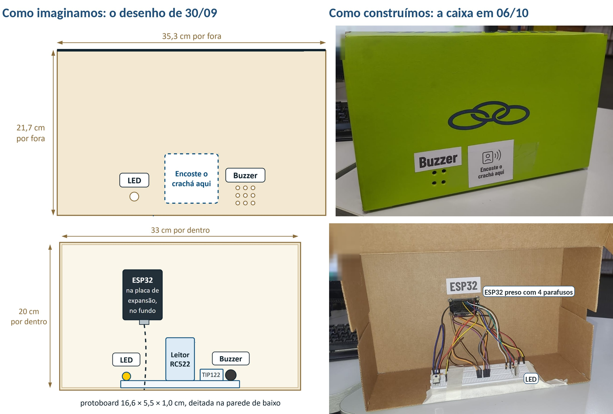
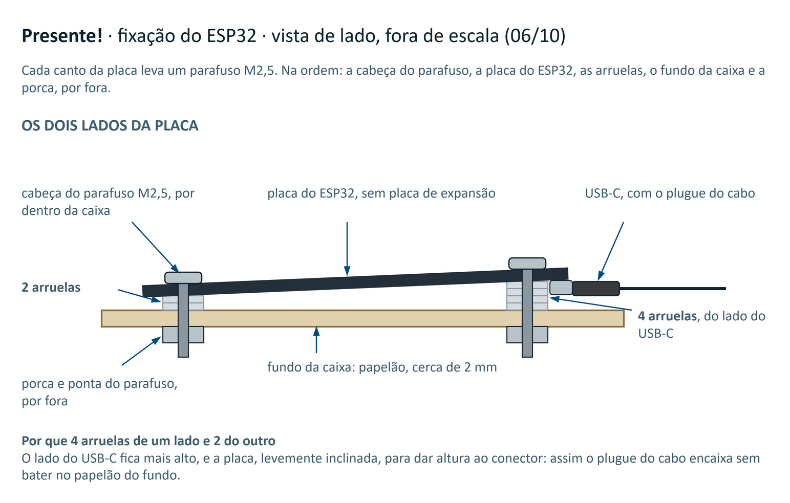
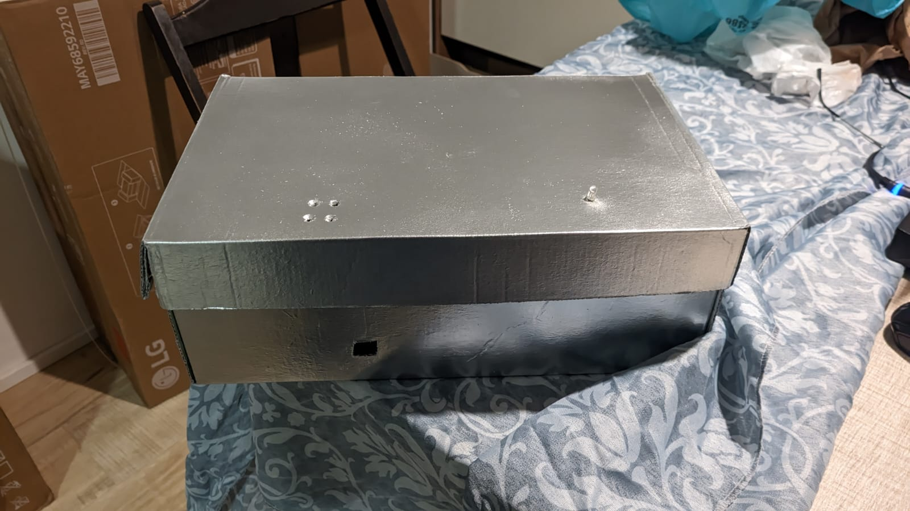
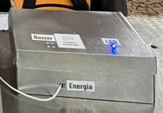

# 3 A ESTRUTURA FÍSICA

O Presente! fica dentro de uma caixa de tênis de papelão, reaproveitada, que montamos em 05/10, na faculdade, com os cinco integrantes. Escolhemos o papelão porque o custo precisava ficar perto de zero e porque ele deixa passar tanto o sinal do leitor de crachá quanto o do Wi-Fi. Depois da Entrega 06, a caixa ganhou o furo do LED na tampa, em 13/10, a pintura de prata, em 22/10, e as cinco etiquetas, em 25/10.

## 3.1 O que o circuito exige da caixa

O leitor RC522 só alcança poucos centímetros, e por isso a face dele, o lado com a antena desenhada, precisa ficar paralela à tampa da frente e o mais perto possível dela, numa parte da tampa com no máximo 2 a 3 mm de espessura, sem metal na frente nem logo atrás. A ponta do ESP32 com a antena do Wi-Fi precisa ficar livre de fios e de metal. E a tampa precisa abrir sem rasgar, para a manutenção e para gravar programa novo com a placa dentro da caixa, segurando o botão BOOT.

## 3.2 A caixa e as peças dentro dela

A caixa mede 33 × 20 × 12 cm por dentro e fica deitada, com a tampa na frente e a dobradiça no lado comprido de cima, de modo que o peso da tampa a mantém fechada e ela abre levantando por baixo. Por dentro, a protoboard fica deitada na parede de baixo, presa com fita crepe e encostada na tampa, com o leitor de pé sobre ela, voltado para a frente; o ESP32 fica na parede do fundo, e o cabo de energia sai por um furo na parede de baixo. A tampa tem cerca de 2 mm de papelão, e é através dela que o leitor lê o crachá. O buzzer fica à esquerda do leitor, com quatro furos para o som na tampa, e o LED, à direita.

O Caio fez o desenho da caixa antes da montagem, com as medidas da caixa real, e o Igor montou um modelo dela no Tinkercad (#57). Na montagem, o buzzer e o LED trocaram de lado, porque a protoboard entrou no sentido inverso ao do desenho, e o som passou a sair por quatro furos, e não pelos nove do desenho (Figura 1).

**Figura 1: O desenho de 30/09, à esquerda, e a caixa montada, nas fotos de 06/10, à direita, de frente e por dentro; na foto de dentro, o leitor RC522 não aparece, porque ficou guardado com o João**

Fonte: elaborado pelos autores (2026).

## 3.3 A fixação do ESP32

Na montagem, o ESP32 ficou solto, pendurado nos fios, porque, por sugestão do João, descartamos a fita dupla-face, já que a placa esquenta. Nessa noite, o leitor parou de responder quando as peças entraram na caixa; a causa provável, não confirmada, é a placa solta, que pode ter puxado algum fio. Em 06/10, prendemos o ESP32 na parede do fundo com quatro parafusos M2,5, um em cada canto, com arruelas que deixam o lado do USB-C mais alto, para o plugue encaixar sem bater no papelão (Figura 2). As porcas e as pontas dos parafusos saem pelo fundo e impediriam a caixa de encostar reta numa parede sem calços; desde 06/10, a caixa fica apoiada na mesa.

**Figura 2: A fixação do ESP32, vista de lado e fora de escala**

Fonte: elaborado pelos autores (2026).

## 3.4 O LED, a pintura e as etiquetas

Com a tampa fechada, o verde que confirma a presença não aparecia, porque o LED ficava na protoboard, atrás da tampa. Na aula de 13/10, fizemos o furo do LED (#58), de 5 mm, na tampa, à direita da etiqueta do leitor, e estendemos cada perna do LED por um jumper macho-fêmea; o LED passou pelo furo e agora fica para fora da caixa.

Em 22/10, depois da última aula antes da exposição, o Caio fez a pintura da caixa (#61), por fora, com tinta spray prateada, a única lata disponível. O plano pedia outra tinta na tampa da frente, porque metal na frente do leitor pode bloquear a leitura, e o Caio decidiu manter a caixa prateada e raspar só a área sobre o leitor se o cartão não fosse lido. Em 25/10, pelo relato do Caio, a placa voltou à caixa, e o cartão foi lido pela tampa pintada, com o verde e o bip, sem raspar nada; no mesmo dia, ele colou as cinco etiquetas: a do leitor, a do LED, a do buzzer, a do ESP32 e a da entrada de energia. A Figura 3 mostra a caixa pintada em 22/10, ainda sem as etiquetas, e a Figura 4, a caixa etiquetada na mesa da exposição de 27/10.

**Figura 3: A caixa pintada de prata em 22/10, ainda sem as etiquetas, com a tampa para cima**

Fonte: elaborado pelos autores (2026).

**Figura 4: A caixa na mesa da exposição, em 27/10, com as etiquetas e o LED aceso; recorte de uma foto da equipe**

Fonte: elaborado pelos autores (2026).

## 3.5 O que mudou depois da Entrega 06

A caixa é reaproveitada e não custou nada. O material, além da caixa e das peças do circuito, foi: quatro parafusos M2,5 com porcas e 12 arruelas, quatro jumpers macho-fêmea, fita crepe, cinco etiquetas de papel impressas, uma lata de tinta spray prateada e, no preparo, estilete, régua, lápis e cola em bastão. A Entrega 06 registra a caixa como estava em 06/10, antes do furo do LED, da pintura e das cinco etiquetas (Quadro 5).

**Quadro 5: O que a Entrega 06 diz e o estado da caixa depois dela**

| Ponto | Na Entrega 06, em 06/10 | Depois |
|----|----|----|
| Furo e etiqueta do LED | Ficariam para a aula de 06/10 | O furo do LED (#58) saiu em 13/10, e a etiqueta foi colada em 25/10 |
| Teste com a caixa fechada | O documento traz o teste de 05/10, com o ESP32 solto | O teste com a caixa fechada foi feito em 06/10, com o ESP32 já preso, e repetido com a caixa pintada em 26/10; nas duas vezes, pelo relato do Caio, o cartão foi lido pela tampa, e os resultados estão na seção dos testes |
| Etiquetas | Quatro coladas | As cinco foram coladas em 25/10, depois da pintura |
| Aparência | Não trata da aparência | A pintura da caixa (#61), de prata, saiu em 22/10, e a leitura pela tampa pintada dispensou a raspagem |
| A data de 27/10 | Demonstração com a caixa presa na parede | Exposição na Semana da Computação, em 27/10, às 18h30, no formato de feira, com a caixa na mesa |

Fonte: elaborado pelos autores (2026).
