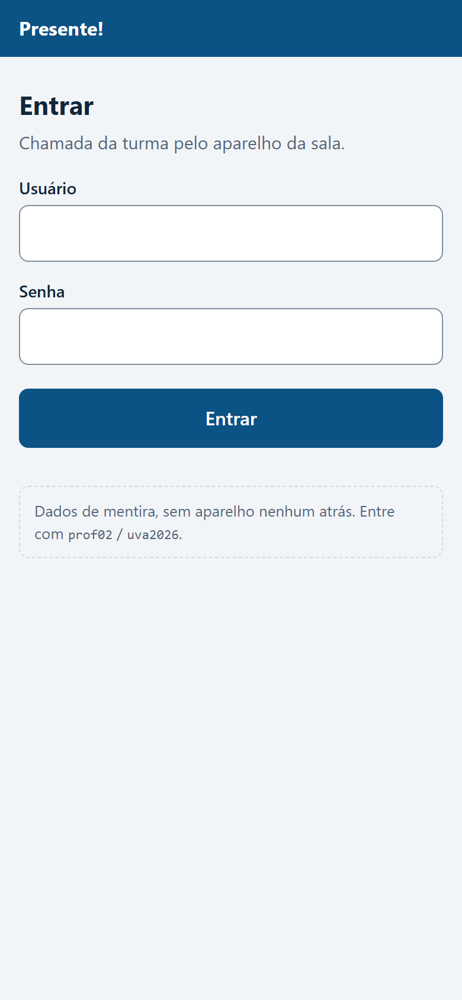
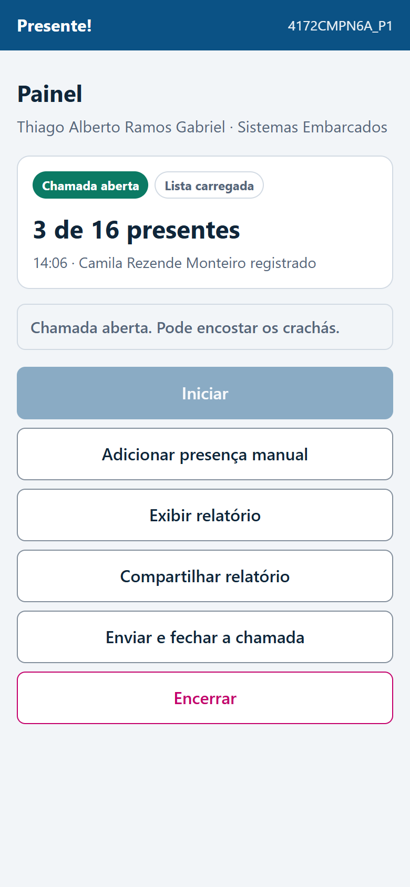
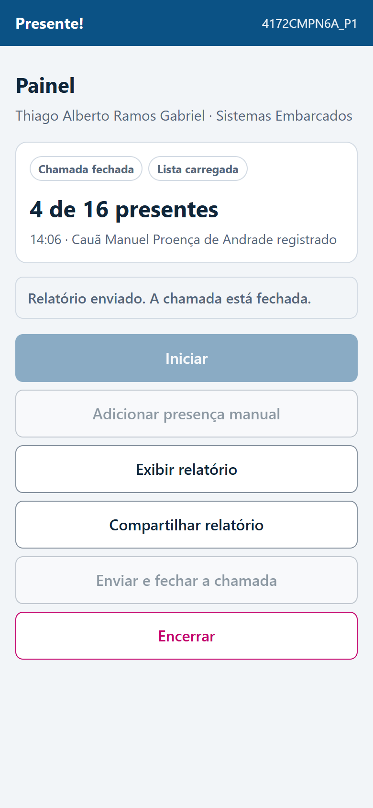
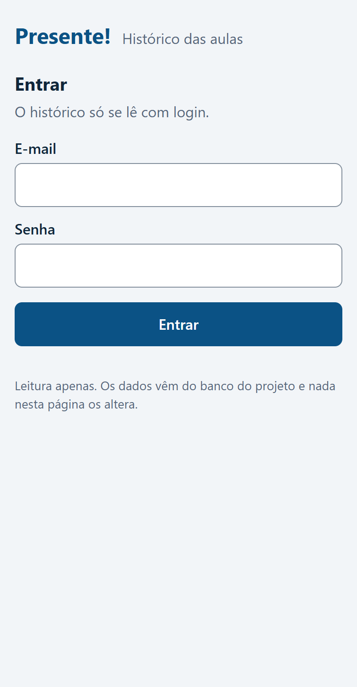
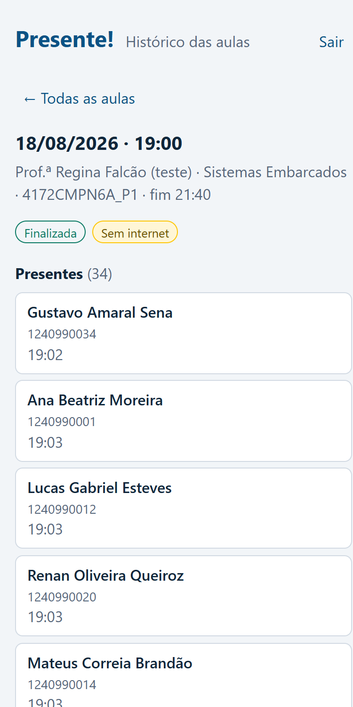
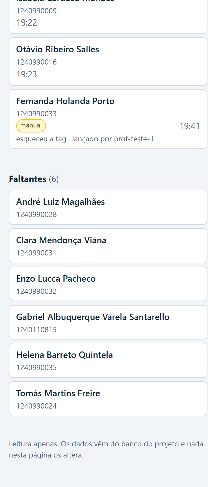

# 4 O PORTAL DO PROFESSOR, A PÁGINA DE HISTÓRICO E O DASHBOARD

O projeto integrador pede um dashboard, com o ESP32 obrigatório, ou uma interface Serial/Processing. Atendemos o pedido com duas páginas, de públicos e momentos diferentes (Quadro 6): o portal do professor, que o próprio ESP32 guarda na memória e serve pela rede Wi-Fi que ele põe no ar, e a página de histórico, publicada na internet, que lê do banco as aulas já registradas. Nos testes, usamos também uma terceira, que lê o monitor serial da placa.

**Quadro 6: As duas partes do dashboard**

| Parte | Onde roda | Com quem fala | Quem usa |
|----|----|----|----|
| Portal do professor | No ESP32, pela rede Wi-Fi do aparelho | Com o aparelho | O professor, durante a aula |
| Página de histórico | Na internet, pelo GitHub Pages | Com o banco na nuvem | Quem tem login no banco, depois da aula |

Fonte: elaborado pelos autores (2026).

## 4.1 O portal do professor

O professor não instala aplicativo. Ele conecta o celular na rede Wi-Fi do aparelho, e o ESP32 responde como um portal cativo, o mesmo mecanismo das redes de hotel, de modo que o celular abre sozinho a página de login (Figura 5). Os arquivos do portal moram na pasta `data/` do repositório e são gravados na memória da placa; são uma página só, sem biblioteca e sem nada vindo da internet, porque na sala a rede do aparelho não tem internet.

O portal e o firmware conversam por nove rotas, que fechamos antes de escrever os dois lados, para que cada um pudesse ser escrito e conferido sozinho. Os dois lados falam em JSON, todo erro vem com um código, pelo qual o portal escolhe a mensagem que mostra ao professor, e todo pedido tem tempo-limite, de 6 segundos, menos o envio ao banco, que espera 25. Nenhuma tela avança sem o aparelho confirmar: quando ele não responde ou recusa, o portal mostra a falha, libera o botão e deixa a tela onde está. As figuras do portal vêm de um aparelho de mentira, um arquivo de JavaScript que responde às mesmas rotas dentro do navegador e só entra quando o endereço da página pede por ele, com `?mentira=1`; por isso a tela de login traz o aviso dos dados de mentira.

Aceita a senha, o aparelho busca a lista da turma no banco, e o portal mostra uma tela de espera; se a busca não terminar em 20 segundos, o aparelho segue sem a lista, no modo offline. O Iniciar abre a chamada, e a partir daí o painel conta os presentes e mostra o último crachá lido, com o nome e a hora, perguntando o estado ao aparelho a cada 2 segundos (Figura 6). O aluno que esqueceu o crachá entra pelo lançamento manual, em que o professor digita a matrícula e, se quiser, o motivo. A hora da chamada é a do celular do professor, que o portal converte para o horário de Brasília, porque o ESP32 não tem relógio com bateria.

O relatório lista os presentes, com a matrícula e a hora da leitura, e os faltantes da turma, e tem duas saídas. O Compartilhar baixa o arquivo no celular do professor, sem passar pela internet, e o botão "Enviar e fechar a chamada" manda a chamada ao banco; confirmado o envio, o leitor para de registrar, e o painel passa a dizer que a chamada está fechada (Figura 7). Se o envio falhar, a chamada continua aberta, e o professor pode tentar de novo ou usar o Compartilhar. O Encerrar apaga do aparelho a lista da turma e as presenças da aula e devolve a tela de login ao próximo professor.

**Figura 5: A tela de login do portal**

Fonte: elaborado pelos autores (2026).

**Figura 6: O painel com a chamada aberta e três presentes**

Fonte: elaborado pelos autores (2026).

**Figura 7: O painel depois do envio, com a chamada fechada**

Fonte: elaborado pelos autores (2026).

Três situações da sala de aula também entraram no portal. Se a página for recarregada com a chamada aberta, o portal volta direto ao painel, sem pedir a senha de novo. Se outra conta entrar com um professor já logado, ela assume o painel enquanto a chamada não começou, e, depois do Iniciar, a chamada continua de quem a iniciou. E, depois de uma queda de energia, a chamada volta como estava, mas o portal pede o login de novo, e o aparelho só torna a ler crachá quando o login lhe devolve a hora.

Para acompanhar as rodadas na placa, o Igor escreveu uma página que lê o monitor serial do ESP32, a forma de interface Serial que o pedido do projeto admite. Ela fica em `docs/testes/monitor.html`, abre no navegador sem internet, mostra em que estado o aparelho está e cada crachá encostado, com o tempo até o sinal, e confere sozinha alguns critérios dos testes. Na exposição de 27/10, ela ficou aberta no notebook ao lado da caixa.

## 4.2 A página de histórico

Ao fim da aula, o aparelho envia a chamada a um banco de dados na nuvem, na plataforma Supabase, e a página de histórico lê esse banco pela internet. Ela não conversa com o aparelho e não altera nada, e a leitura exige e-mail e senha. O Igor escreveu a página porque a apresentação precisa mostrar um sistema, e não só um leitor de crachá. O portal do professor morre com a aula, e, sem uma tela que leia o banco, o histórico seria uma afirmação nossa, e não uma coisa que o professor pode abrir e conferir. Ela está no ar em https://caioplaninschek.github.io/presente/ desde 13/10.

Depois do login (Figura 8), a lista mostra as aulas da mais recente para a mais antiga, com a data e a hora, o professor, a turma, a situação e o modo, "Com internet" ou "Sem internet". Ao abrir uma aula, a página mostra os presentes, cada aluno uma vez só, com a matrícula e o horário da primeira leitura, e os faltantes da turma, e a presença lançada à mão vem marcada, com o motivo e quem a lançou (Figuras 9 e 10). As figuras desta seção são de 13/10, com aulas de teste; em 14/10 esvaziamos o banco, para que as primeiras aulas de verdade não se misturassem às inventadas.

**Figura 8: A tela de login da página de histórico**

Fonte: elaborado pelos autores (2026).

**Figura 9: O começo de uma aula, com os presentes**

Fonte: elaborado pelos autores (2026).

**Figura 10: O fim da mesma aula, com a presença lançada à mão e os faltantes**

Fonte: elaborado pelos autores (2026).

Nenhuma credencial do banco fica no repositório: a cada publicação, o GitHub monta a configuração da página com o endereço do banco e a chave publicável, guardados como segredos do repositório. A chave fica visível para quem abre a página, e aceitamos esse custo porque, sozinha, ela não lê tabela nenhuma nem o histórico: o banco só libera a leitura das tabelas depois do login.
